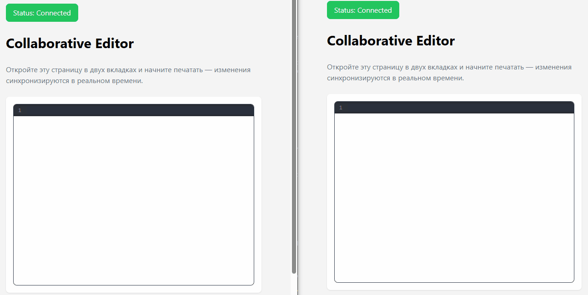

# Collab Editor


Совместный текстовый редактор в реальном времени на **React + TypeScript + Yjs (CRDT)** с собственным WebSocket-сервером на **Fastify**.

## Live Demo

> Вставьте ссылку на деплой, когда будет (например, Vercel + Render/Railway).

## Особенности

- Совместное редактирование текста в реальном времени (CRDT через Yjs)
- Несколько комнат: каждый URL `http://localhost:5173/doc/abc123` — отдельная комната
- Сохранение документов на сервере (LevelDB)
- TypeScript на клиенте и сервере
- Минималистичный UI в стиле Notion

## Стек

- **Frontend**: React 18, TypeScript, Vite, Yjs, y-websocket
- **Backend**: Node.js, Fastify, WebSocket, y-protocols, y-leveldb
- **Хранение**: LevelDB (инкрементальные Yjs-обновления)

## Скриншот


Изменения, внесённые в одной вкладке, появляются в другой в реальном времени.

## Быстрый старт

### Требования

- Node.js 18+
- npm или pnpm

### Установка

```bash
# Клонировать репозиторий
git clone [https://github.com/Ad-Abzatov/collab-editor.git](https://github.com/Ad-Abzatov/collab-editor.git)
cd collab-editor

# Установить зависимости
cd client && npm install
cd ../server && npm install
```

### Запуск

```bash
# Терминал 1 — сервер
cd server
npx tsx src/index.ts

# Терминал 2 — клиент
cd client
npm run dev
```

Откройте `http://localhost:5173` в двух вкладках браузера и начните печатать.

## Как это работает

1. Клиент подключается к комнате через `y-websocket`
2. Сервер хранит Yjs-документы в памяти и персистит обновления в LevelDB
3. Изменения синхронизируются через CRDT — конфликтов нет, порядок не важен

## Что можно добавить

- Rich-text (Tiptap + Yjs)
- Курсоры пользователей (awareness)
- Аутентификацию и список документов пользователя
- Деплой на Vercel + Railway/Render

## Лицензия

MIT